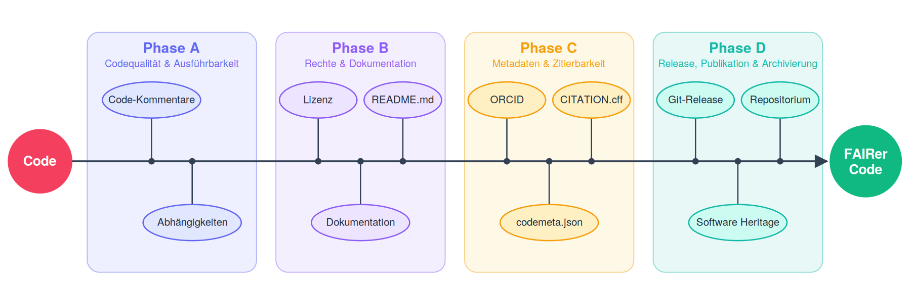

# Wie veröffentliche ich Code FAIR?

Forschungsergebnisse werden heutzutage im großen Maße durch selbstentwickelte Software bzw. codebasierte Skripte generiert.
Dabei wird dieser Code als Teil der eigenen Forschung betrachtet.  
Die FAIR-Prinzipien (Findable, Accessible, Interoperable, Reusable) haben sich in den vergangenen Jahren seit ihrer Definition durch Wilkinson _et al._ (2016)[^1], v.a. im Zusammenhang mit Forschungsdaten und deren nachhaltiger Nutzung, weit verbreitet.
Die FAIRe Verfügbarmachung von Code hinkt, im Vergleich zur wissenschaftlichen Veröffentlichung und zur Forschungsdatenpublikation, hinterher.  
Es liegt also nahe, gerade im Open Access Bereich, auch Code FAIR zu veröffentlichen, damit er in der wissenschaftlichen Community einerseits auffindbar sowie wiederverwendbar ist und andererseits seine Urheber*innen entsprechende „Credits“ bei Wiederverwendung bekommen.

[^1]: Wilkinson, M., Dumontier, M., Aalbersberg, I. _et al._ (2016). **The FAIR Guiding Principles for scientific data management and stewardship**. Scientific Data 3, 160018. [https://doi.org/10.1038/sdata.2016.18](https://doi.org/10.1038/sdata.2016.18){:target="_blank"}

## Guideline des FAIRagro Helpdesks

!!! tip inline end "Fahrplan zur FAIRen Code-Veröffentlichung 2.0"
	Peschel _et al._ (2026): [**Fahrplan zur FAIRen Code-Veröffentlichung 2.0**](https://doi.org/10.5281/zenodo.14772748){:target="_blank"}

Der FAIRagro Helpdesk hat aus diesem Grund Anfang 2025 einen [Fahrplan zur FAIRen Code-Veröffentlichung](https://doi.org/10.5281/zenodo.14772749){:target="_blank"}[^2] herausgegeben.
Seitdem hat sich die Codeerstellung stark verändert, vor allem durch generative KI und Coding-Agenten.
Im Herbst 2026 ist daher eine neue [Version 2.0 des Fahrplans](https://doi.org/10.5281/zenodo.14772748){:target="_blank"}[^3] erschienen, die diese Entwicklungen in jedem Schritt berücksichtigt.
Die vorgestellten Maßnahmen sind dabei als aktuelle Empfehlungen (Stand Herbst 2026) zu betrachten.
Im betrachteten Thema ändern sich Dinge schnell und es ist fraglich, welche Methoden/Tools/etc. zukünftig zu Standards und welche aus mangelnder Unterstützung aus der Community nicht weiter verfolgt werden.

[^2]: Beyer, F., Vedder, L., Singson, L. S., Sahwan, W. & Schmidt, M. (2025). **Publishing research code FAIR - a roadmap**. Zenodo. [https://doi.org/10.5281/zenodo.14772749](https://doi.org/10.5281/zenodo.14772749){:target="_blank"}

[^3]: Peschel, P., Beyer, F., Möller, M., Singson, L. S., Vedder, L., Sahwan, W. & Schmidt, M. (2026). **Fahrplan zur FAIRen Code-Veröffentlichung 2.0**. Zenodo. [https://doi.org/10.5281/zenodo.14772748](https://doi.org/10.5281/zenodo.14772748){:target="_blank"}

/// caption
Fahrplan zur FAIRen Veröffentlichung von wissenschaftlichem Code. (Peschel _et al._ 2026)[^3]
///

---
# <small>Mitwirkende</small>
:fontawesome-solid-user: Lucia Vedder {:target="_blank"},
:fontawesome-solid-user: Florian Beyer {:target="_blank"},
:fontawesome-solid-user: Paul Peschel {:target="_blank"}

(*Letztes Update: 2026-10-13*)

---
#<small>Wie zitiert man diese Seite?</small>
Vedder, L., Beyer, F. & Peschel, P. (2026). *FAIRe Code-Veröffentlichung*. FAIRagro Knowledge Base. [https://knowledgebase.fairagro.net/rdm/fair_code/](https://knowledgebase.fairagro.net/rdm/fair_code/). Unter: [CC BY 4.0](https://creativecommons.org/licenses/by/4.0/){:target="_blank"}.  

{:target="_blank"}
